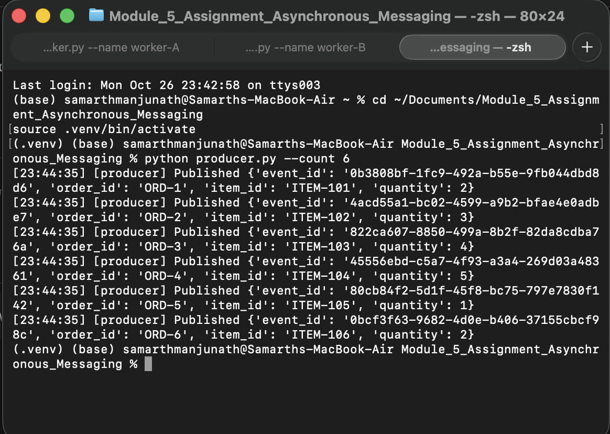
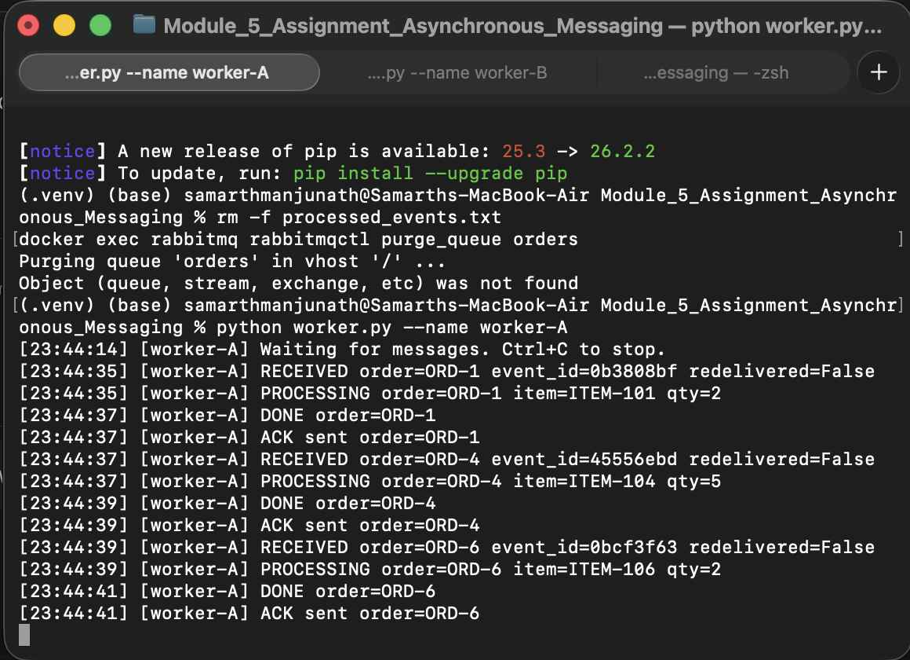
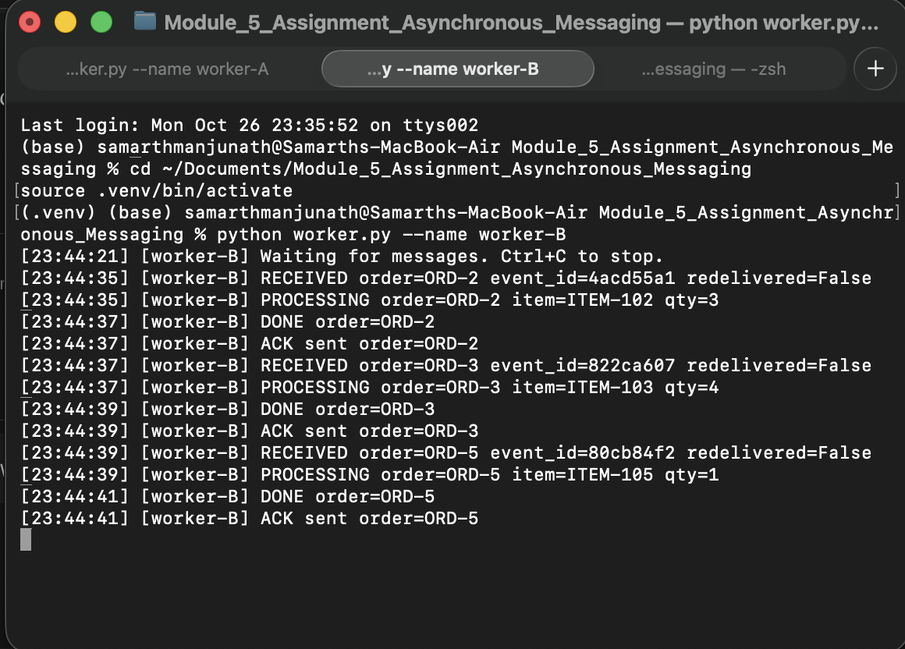
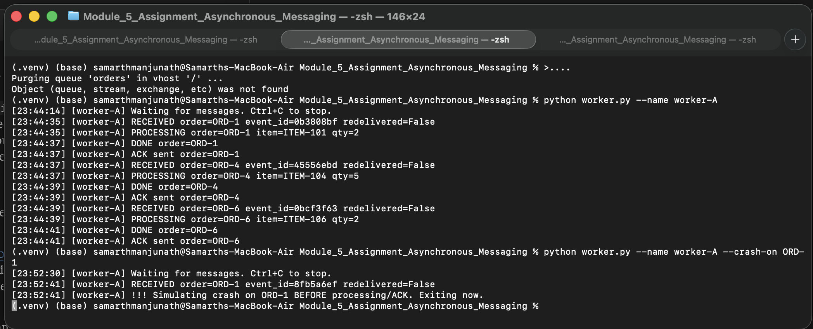
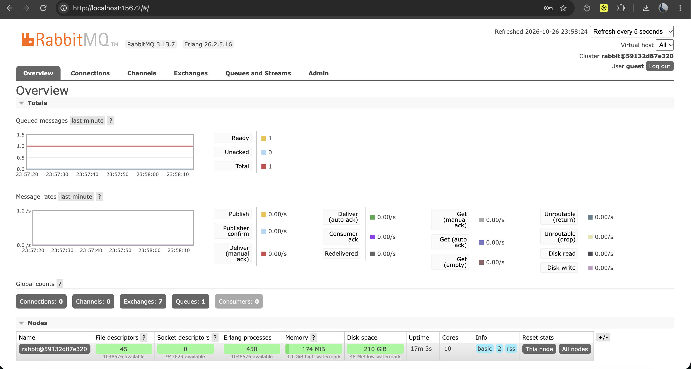
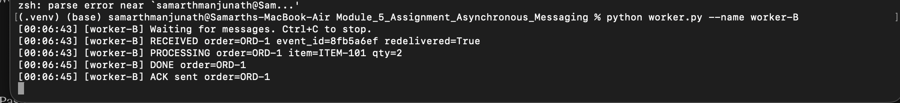
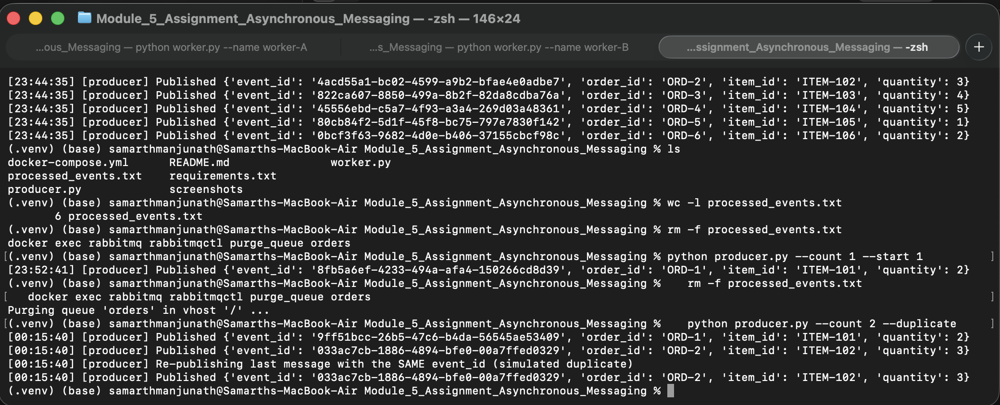
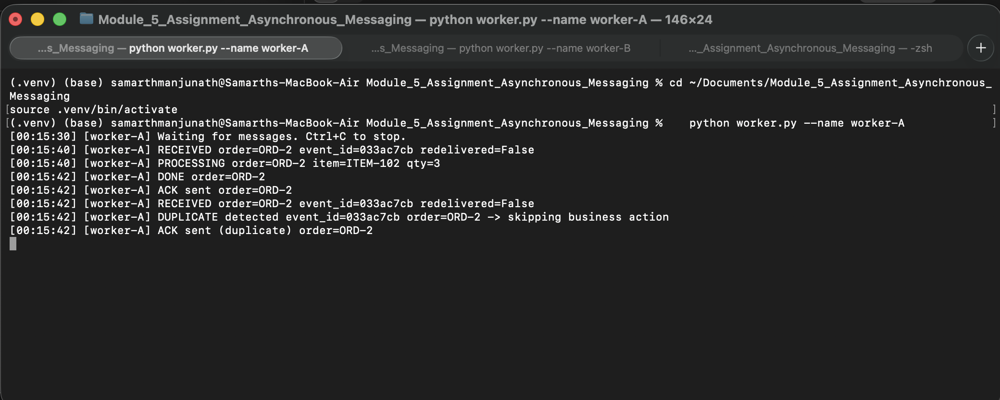

# Module 5 – Asynchronous Messaging with RabbitMQ

A small order-processing system built with **Python + pika** and **RabbitMQ**.
The producer and workers are independent processes that communicate only through a durable queue.

## Files

| File | Purpose |
|---|---|
| `producer.py` | Publishes order messages (`event_id`, `order_id`, `item_id`, `quantity`) |
| `worker.py` | Consumes orders, logs them, ACKs after processing, skips duplicate `event_id`s |
| `docker-compose.yml` | Runs RabbitMQ with the management UI |
| `requirements.txt` | Python dependency (`pika`) |
| `screenshots/` | Evidence screenshots |

## Architecture

```
                         +-----------------------+
 +------------+ publish   |       RabbitMQ        |  deliver   +------------+
 |  Producer  | --------> |   queue: "orders"     | ---------> |  Worker A  |
 +------------+           |   (durable, persistent|  (one msg  +------------+
                          |    messages)          |   goes to  +------------+
                          +-----------------------+ -------->  |  Worker B  |
                                                    one worker +------------+
                                                         |           |
                                                         v           v
                                               processed_events.txt (shared dedup store)
```

- Messages are **persistent** and the queue is **durable**.
- Workers use **manual ACK** (`auto_ack=False`) and `prefetch_count=1`.
- If a worker dies before ACKing, RabbitMQ requeues the message and delivers it to another worker (`redelivered=True`).
- Processed `event_id`s are stored in `processed_events.txt`, shared by all workers.

## How to run

Prerequisites: Docker Desktop and Python 3.9+.

```bash
# 1. Start RabbitMQ (management UI: http://localhost:15672, guest / guest)
docker compose up -d

# 2. Create a virtual environment and install dependencies
python -m venv .venv
source .venv/bin/activate          # Windows: .venv\Scripts\activate
pip install -r requirements.txt

# 3. Start two workers, each in its own terminal (activate the venv in each)
python worker.py --name worker-A
python worker.py --name worker-B

# 4. Publish orders from a third terminal
python producer.py --count 6
```

Reset between demos:

```bash
rm -f processed_events.txt
docker exec rabbitmq rabbitmqctl purge_queue orders
```

Options used in the demos:

| Command | Meaning |
|---|---|
| `worker.py --crash-on ORD-1` | Kill the worker when it receives `ORD-1`, **before** processing and ACK |
| `worker.py --crash-on ORD-1 --crash-after-process` | Process the order, then kill the worker **before** the ACK |
| `producer.py --count N --start N` | Publish N orders starting at `ORD-<start>` |
| `producer.py --duplicate` | Re-publish the last message with the **same** `event_id` |

## 1. Successful message processing

The producer published 6 orders:

```
[23:44:35] [producer] Published {'event_id': '0b3808bf-...', 'order_id': 'ORD-1', 'item_id': 'ITEM-101', 'quantity': 2}
[23:44:35] [producer] Published {'event_id': '4acd55a1-...', 'order_id': 'ORD-2', 'item_id': 'ITEM-102', 'quantity': 3}
[23:44:35] [producer] Published {'event_id': '822ca607-...', 'order_id': 'ORD-3', 'item_id': 'ITEM-103', 'quantity': 4}
[23:44:35] [producer] Published {'event_id': '45556ebd-...', 'order_id': 'ORD-4', 'item_id': 'ITEM-104', 'quantity': 5}
[23:44:35] [producer] Published {'event_id': '80cb84f2-...', 'order_id': 'ORD-5', 'item_id': 'ITEM-105', 'quantity': 1}
[23:44:35] [producer] Published {'event_id': '0bcf3f63-...', 'order_id': 'ORD-6', 'item_id': 'ITEM-106', 'quantity': 2}
```

Each order is received, logged, processed, and ACKed, for example:

```
[23:44:35] [worker-A] RECEIVED order=ORD-1 event_id=0b3808bf redelivered=False
[23:44:35] [worker-A] PROCESSING order=ORD-1 item=ITEM-101 qty=2
[23:44:37] [worker-A] DONE order=ORD-1
[23:44:37] [worker-A] ACK sent order=ORD-1
```



## 2. Competing consumers

Two workers were connected to the same `orders` queue. Each message was handled by exactly one worker:

| Worker | Orders handled |
|---|---|
| worker-A | ORD-1, ORD-4, ORD-6 |
| worker-B | ORD-2, ORD-3, ORD-5 |

No order appears in both logs, and all 6 orders were processed and ACKed.

**worker-A**



**worker-B**



## 3. Failure and redelivery

**Setup:** `worker-A` was started with `--crash-on ORD-1`, and a single order (`ORD-1`, `event_id=8fb5a6ef`) was published.

### Step 1: worker-A receives the message and dies before the ACK

```
[23:52:30] [worker-A] Waiting for messages. Ctrl+C to stop.
[23:52:41] [worker-A] RECEIVED order=ORD-1 event_id=8fb5a6ef redelivered=False
[23:52:41] [worker-A] !!! Simulating crash on ORD-1 BEFORE processing/ACK. Exiting now.
```

No `ACK sent` line appears. The process exits with the message unacknowledged.



### Step 2: the message returns to the queue

RabbitMQ detected the closed connection and put the message back: **Ready = 1, Unacked = 0, Consumers = 0**.



### Step 3: worker-B receives the same message again

`worker-B` was then started. It received the **same** `event_id=8fb5a6ef` with `redelivered=True`, processed it, and ACKed:

```
[00:06:43] [worker-B] Waiting for messages. Ctrl+C to stop.
[00:06:43] [worker-B] RECEIVED order=ORD-1 event_id=8fb5a6ef redelivered=True
[00:06:43] [worker-B] PROCESSING order=ORD-1 item=ITEM-101 qty=2
[00:06:45] [worker-B] DONE order=ORD-1
[00:06:45] [worker-B] ACK sent order=ORD-1
```



### Step 4: the system keeps running

New orders published afterwards (`producer.py --count 2 --start 2`) were processed normally by the same worker:

```
[00:07:59] [worker-B] RECEIVED order=ORD-2 event_id=d23a6ea6 redelivered=False
[00:07:59] [worker-B] PROCESSING order=ORD-2 item=ITEM-102 qty=3
[00:08:01] [worker-B] DONE order=ORD-2
[00:08:01] [worker-B] ACK sent order=ORD-2
[00:08:01] [worker-B] RECEIVED order=ORD-3 event_id=80038ceb redelivered=False
[00:08:01] [worker-B] PROCESSING order=ORD-3 item=ITEM-103 qty=4
[00:08:03] [worker-B] DONE order=ORD-3
[00:08:03] [worker-B] ACK sent order=ORD-3
```

## 4. Duplicate handling

The worker stores each processed `event_id` in `processed_events.txt`. If an `event_id` has already been processed, it logs a duplicate, skips the business action, and still ACKs so the message is removed from the queue.

Test: `python producer.py --count 2 --duplicate` publishes ORD-1, ORD-2, and then ORD-2 again with the **same** `event_id` (`033ac7cb`). Both workers were running, so ORD-1 went to worker-B while ORD-2 and its duplicate went to worker-A.

**Producer**

```
[00:15:40] [producer] Published {'event_id': '9ff51bcc-26b5-47c6-b4da-56545ae53409', 'order_id': 'ORD-1', 'item_id': 'ITEM-101', 'quantity': 2}
[00:15:40] [producer] Published {'event_id': '033ac7cb-1886-4894-bfe0-00a7ffed0329', 'order_id': 'ORD-2', 'item_id': 'ITEM-102', 'quantity': 3}
[00:15:40] [producer] Re-publishing last message with the SAME event_id (simulated duplicate)
[00:15:40] [producer] Published {'event_id': '033ac7cb-1886-4894-bfe0-00a7ffed0329', 'order_id': 'ORD-2', 'item_id': 'ITEM-102', 'quantity': 3}
```



**Worker-A:** ORD-2 is processed once; the second copy is detected as a duplicate and the business action is skipped:

```
[00:15:30] [worker-A] Waiting for messages. Ctrl+C to stop.
[00:15:40] [worker-A] RECEIVED order=ORD-2 event_id=033ac7cb redelivered=False
[00:15:40] [worker-A] PROCESSING order=ORD-2 item=ITEM-102 qty=3
[00:15:42] [worker-A] DONE order=ORD-2
[00:15:42] [worker-A] ACK sent order=ORD-2
[00:15:42] [worker-A] RECEIVED order=ORD-2 event_id=033ac7cb redelivered=False
[00:15:42] [worker-A] DUPLICATE detected event_id=033ac7cb order=ORD-2 -> skipping business action
[00:15:42] [worker-A] ACK sent (duplicate) order=ORD-2
```



**Worker-B** handled ORD-1 (`event_id=9ff51bcc`) normally.

## Notes and limitations

- Deduplication uses a simple shared file (`processed_events.txt`), which is enough for this lab. Two workers receiving the same `event_id` at the exact same instant could race; a production system would use an atomic store such as a database unique constraint or Redis `SETNX`.
- A message is recorded as processed *before* the ACK. If a worker crashes between those two steps (`--crash-after-process`), the redelivered message is correctly detected as a duplicate.

## Reflection

A message can be delivered more than once because RabbitMQ only removes a message after it receives an ACK. If a worker crashes, loses its connection, or the ACK is lost after the work was already done, the broker requeues the message and another worker receives it. This is at-least-once delivery, so duplicates are normal rather than rare. Idempotent handling, here tracking processed `event_id` values, ensures a repeated delivery does not repeat the business action (for example charging or shipping an order twice). That makes retries safe and gives an effectively-once result.
